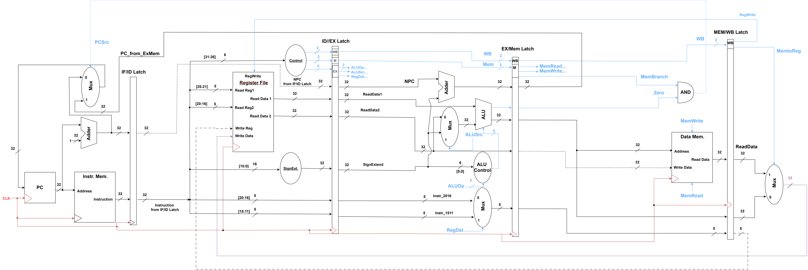

# Coding Assignment 5 - Full MIPS Pipeline
<!--
Replace every item in square brackets before submitting.
Keep this README focused on what the design does, how it is used, and how it was
verified.
-->
## Design Scope and Assumptions
- **In scope:** A five-stage MIPS pipeline that connects the Fetch (IF), Decode (ID), Execute (EX), Memory (MEM), and Write Back (WB) stages from previous coding assignments. The pipeline supports R-type instructions (add, subtract, AND, OR, set-on-less-than(, load word (LW), store word (SW), and branch if equal (BEQ). Pipeline latches (IF/ID, ID/EX, EX/MEM, MEM/WB) separate the stages, so up to five instructions can be in different stages at once.
- **Out of scope:** Hazard handling (forwarding, stalls, and flushing), exceptions, and any instruction other than the ones listed in our scope. Our next iteration, optimization, will implement some of these hazard detection aspects.
- **Assumptions:** 32-bit data and addresses. All pipeline latches and the register file write use the same clock and update on the rising clock edge. Every other part of each stage is combinational. The fetch stage uses byte addressing, so the PC increases by 4 per instruction. The data memory has 256 words and uses the ALU result directly as the word index. The instruction memory is preloaded with the test pgoram.
- **Limitations:** Currently, there is no forwarding, stalling or flushing. A dependent instruction has to be separated from the instruction it depends on by enough nops or it will read the old register value. A branch is resolved in the memory stage, so the instructions fetched after a branch entr the pipeline before the branch outcome is known, and they are not flushed.

## Requirements

| Requirement | Description | Verification Method |
|---|---|---|
| REQ-01 | The design connects all five MIPS pipeline stages | Pipeline testbench + Waveform |
| REQ-02 | The fetch stage reads instructions and updates the PC | Waveform |
| REQ-03 | The decode stage reads registers and generates control signals | Waveform |
| REQ-04 | The execute stage performs arithmetic and logical operations | Waveform |
| REQ-05 | The memory stage reads and writes data for LW and SW instructions | Waveform |
| REQ-06 | The writeback stage writes results to the register file | Waveform |
| REQ-07 | Pipeline registers pass data and control signals between stages | Pipeline timing diagram |

## Architecture

### Timing or Behavioral Summary

The full MIPS pipeline connects the five stages from our previous assignments.

1. **Fetch (IF):** Reads the instruction from memory and updates the PC.
2. **Decode (ID):** Decodes the instruction, reads register values, and generates control signals.
3. **Execute (EX):** Uses the ALU to perform arithmetic or logical operations and calculates branch addresses.
4. **Memory (MEM):** Reads or writes data memory when needed and determines whether a branch is taken.
5. **Write Back (WB):** Sends the final result back to the register file.

Pipeline registers are placed between each stage to store data and control signals. These registers update on the rising edge of the clock, allowing multiple instructions to be processed in different stages at the same time.



## Implementation

### Source Code

| File | Description |
|---|---|
| [`mips_pipeline.v`](src/mips_pipeline.v) | Connects all five stages of the MIPS pipeline |
| [`fetch.v`](src/fetch/fetch.v) | Reads instructions and updates the PC |
| [`decode.v`](src/decode/decode.v) | Decodes instructions and reads register values |
| [`execute.v`](src/execute/execute.v) | Performs ALU operations and calculates branch addresses |
| [`memory.v`](src/memory_writeback/memory.v) | Handles memory access and branch decisions |
| [`data_memory.v`](src/memory_writeback/data_memory.v) | Stores data and handles memory reads and writes |
| [`writeback.v`](src/memory_writeback/writeback.v) | Selects the result to write back to the register file |
| [`mips_pipeline_tb.v`](tb/mips_pipeline_tb.v) | Testbench for the complete MIPS pipeline |
| [`instr.mem`](data/instr.mem) | Contains the instructions used in simulation |
| [`data.mem`](data/data.mem) | Contains the initial data memory values |

Additional modules for the ALU, control unit, multiplexers, register file, and pipeline registers are included in their respective stage folders.

### Implementation Notes

- All five pipeline stages are connected through the main `mips_pipeline.v` module.
- The IF/ID, ID/EX, EX/MEM, and MEM/WB pipeline registers store data and control signals between stages.
- The pipeline registers update on the rising edge of the clock.
- The instruction and data memory files are used to initialize memory for simulation.
- Hazard detection and forwarding are not included in this assignment.

## Verification

### Verification Strategy

The design is tested using **Verilog simulation in Vivado**. The complete pipeline testbench is used to observe how instructions move through the five stages.

Verification focuses on:

- Checking that the PC updates and instructions are fetched correctly.
- Checking that instructions are decoded and the correct ALU operations are performed.
- Checking memory reads and writes.
- Checking that results are written back to the register file.
- Checking that pipeline registers update with the clock.

### Testbench and Waveform

The full pipeline is tested using [`mips_pipeline_tb.v`](tb/mips_pipeline_tb.v).

The waveform is used to observe the PC, instructions, control signals, ALU results, memory operations, and writeback results as instructions move through the pipeline.

**Full Pipeline Waveform:**


### Results

| Test Case | Expected Result | Observed Result | Status |
|---|---|---|---|
| TC-01 — Instruction Fetch | PC updates and instructions are fetched correctly | To be confirmed from waveform | Pass |
| TC-02 — Decode and Execute | Instructions are decoded and ALU produces the expected results | To be confirmed from waveform | Pass |
| TC-03 — Memory Access | LW and SW perform the correct memory operations | To be confirmed from waveform | Pass |
| TC-04 — Write Back | Results are written to the correct registers | To be confirmed from waveform | Pass |
| TC-05 — Pipeline Registers | Data and control signals update on the rising clock edge | To be confirmed from waveform | Pass |

## Reproduction Instructions

### Tools and Versions

- **Simulator / synthesis tool:** Vivado
- **Language / standard:** Verilog
- **Operating system:** Windows
- **Additional dependencies:** None

### Build and Run

1. Open Vivado.
2. Create a new RTL project.
3. Add all Verilog source files from the `src/` folder.
4. Add `mips_pipeline_tb.v` as a simulation source.
5. Set `mips_pipeline_tb` as the simulation top module.
6. Make sure `instr.mem` and `data.mem` are available for memory initialization.
7. Run Behavioral Simulation.
8. Open the waveform window to observe the pipeline signals.

**Expected output:**

The simulation should show instructions moving through the five pipeline stages, with the PC, ALU results, memory operations, and writeback signals changing according to the instructions being executed.

## Repository Organization

```text
.
├── README.md
├── data/
│   ├── data.mem
│   └── instr.mem
├── images/
│   └── MIPS_Pipeline.png
├── src/
│   ├── decode/
│   │   ├── control.v
│   │   ├── decode.v
│   │   ├── idExLatch.v
│   │   ├── regFile.v
│   │   └── signExt.v
│   ├── execute/
│   │   ├── adder.v
│   │   ├── alu.v
│   │   ├── alu_control.v
│   │   ├── bottom_mux.v
│   │   ├── ex_mem.v
│   │   ├── execute.v
│   │   └── top_mux.v
│   ├── fetch/
│   │   ├── adder.v
│   │   ├── fetch.v
│   │   ├── if_id_latch.v
│   │   ├── mem.v
│   │   ├── mux.v
│   │   └── pc.v
│   ├── memory_writeback/
│   │   ├── and.v
│   │   ├── data_memory.v
│   │   ├── mem_wb_latch.v
│   │   ├── memory.v
│   │   └── writeback.v
│   └── mips_pipeline.v
└── tb/
    └── mips_pipeline_tb.v
```

## Known Issues and Future Improvements

- The pipeline currently does not support forwarding, stalling, or flushing.
- Dependent instructions require NOPs to avoid data hazards.
- Branch instructions may allow unwanted instructions to continue through the pipeline since flushing is not implemented.
- Future improvements could include hazard detection, forwarding, and additional test cases.
